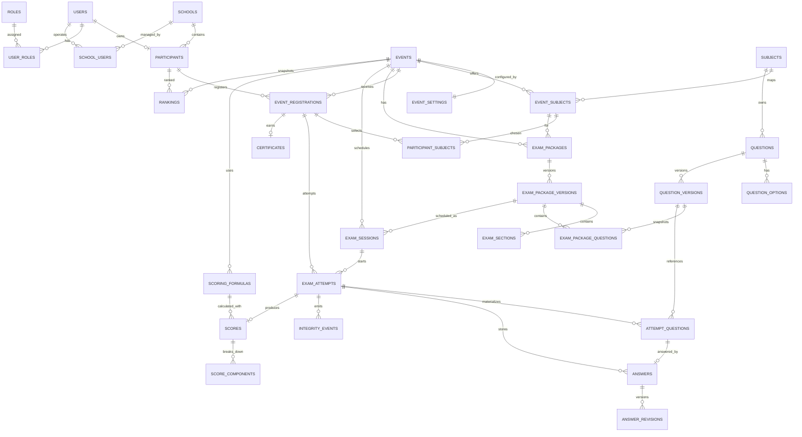
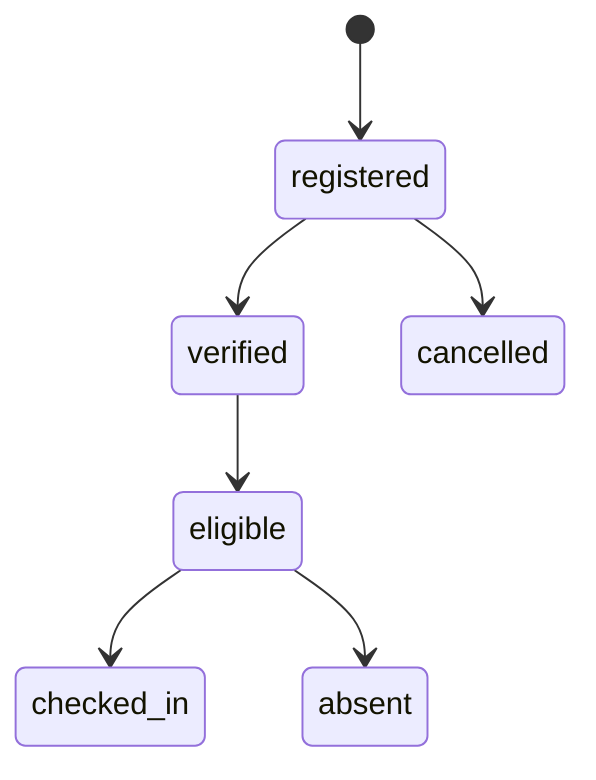
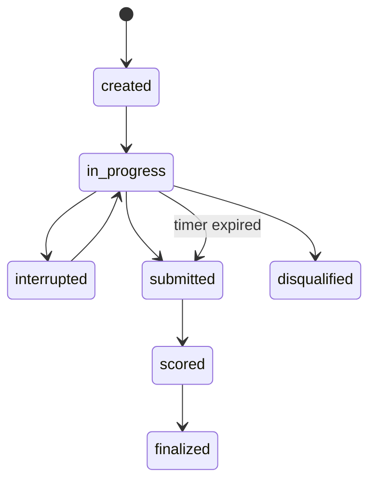
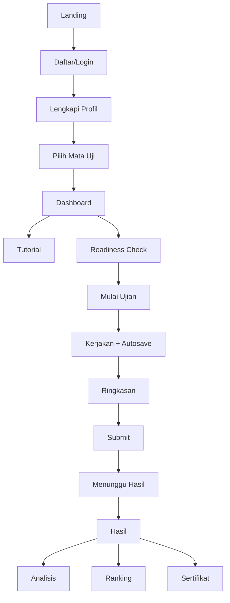
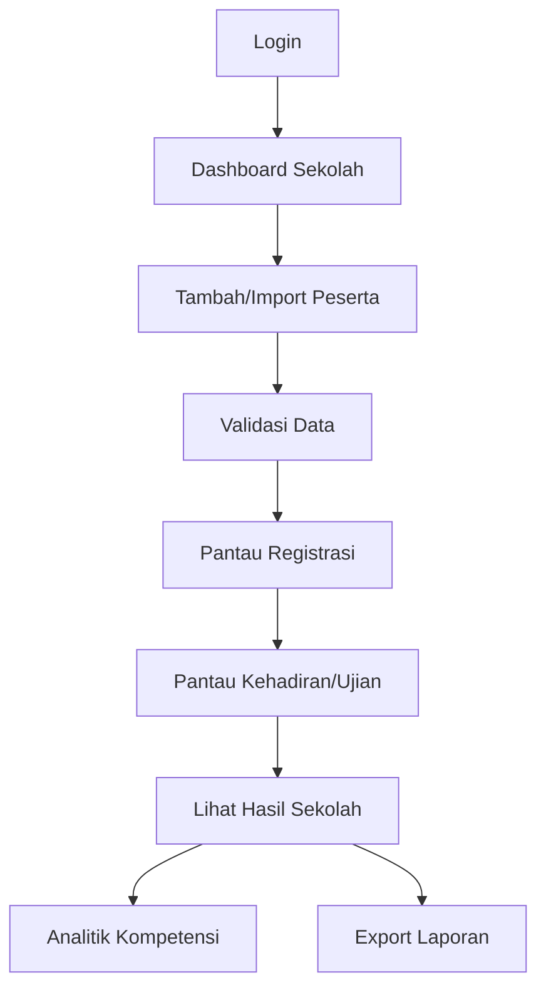
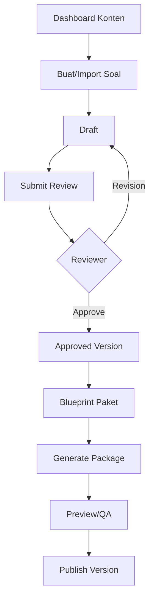
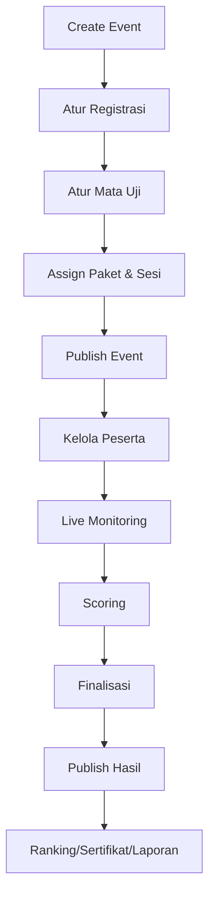
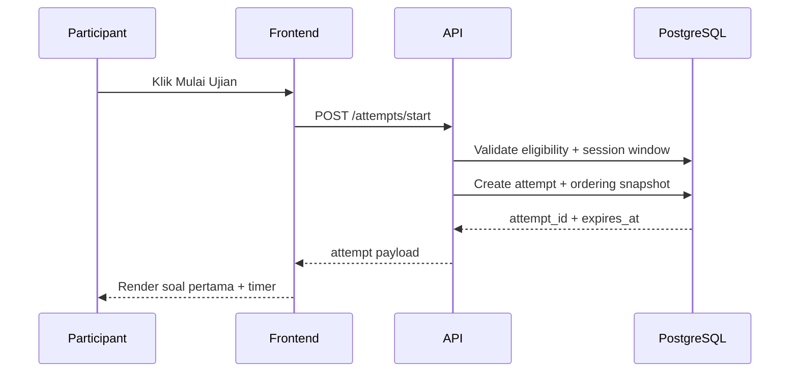
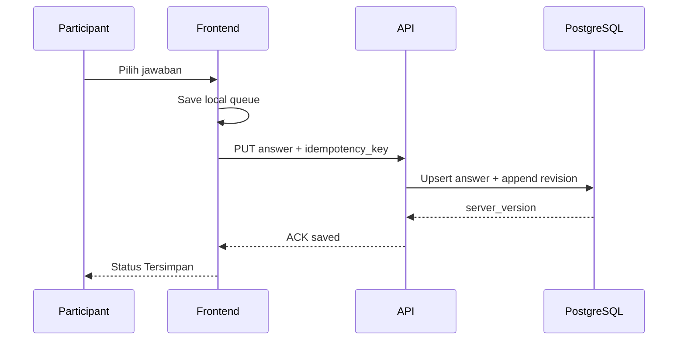
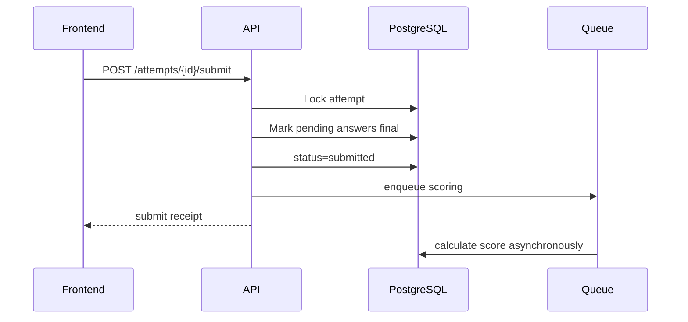

# Technical Design: ERD, Database Schema, User Flow & Wireframe
## Platform Tryout TKA Tingkat SMA/MA/SMK

**Versi:** Versi 1.0  
**Tanggal:** 4 September 2026  
**Status:** Technical Design Draft

> Dokumen ini merupakan turunan teknis dari PRD TKA Tryout Platform. Fokusnya adalah struktur data, relasi sistem, user flow, dan wireframe low-fidelity yang dapat langsung menjadi acuan UI/UX dan engineering.

---

## 1. Prinsip Desain Teknis

1. **Configurable first** — aturan mata uji, durasi, jumlah soal, scoring, ranking, dan hasil tidak di-hardcode.
2. **Immutable exam package** — paket yang sudah dipublish tidak diedit; perubahan menghasilkan versi baru.
3. **Server authoritative time** — waktu ujian ditentukan server, bukan jam perangkat peserta.
4. **Answer durability** — jawaban disimpan lokal + server, retry idempotent, dan dapat pulih setelah reconnect.
5. **Auditability** — aksi sensitif admin, perubahan soal, scoring, dan override tercatat.
6. **Privacy by role** — peserta hanya melihat dirinya; operator sekolah hanya sekolahnya; admin sesuai scope.
7. **Scalable read/write path** — penulisan jawaban, monitoring, scoring, dan export dipisahkan sesuai beban.

## 2. Bounded Context / Modul Sistem

- **Identity & Access** — users, roles, permissions, sessions.
- **School & Participant** — sekolah, peserta, operator sekolah, registrasi.
- **Event Configuration** — event, settings, subjects, sessions.
- **Question Management** — bank soal, soal, versi, opsi, review.
- **Exam Delivery** — package, version, attempt, question snapshot, answers.
- **Integrity & Monitoring** — event log, heartbeat, incident.
- **Scoring & Results** — formula, scores, components, rankings.
- **Certificate & Reporting** — certificate, export, school report.
- **Notification & Integration** — email, WhatsApp, CRM/webhook.
- **Governance** — audit log, system settings.

## 3. ERD — High Level



## 4. Entity Catalog

| Entity | Fungsi | Primary Key | Relasi Utama |
|---|---|---|---|
| users | Akun seluruh pengguna sistem | id (UUID) | - |
| roles | Master role | id | - |
| permissions | Master permission | id | - |
| role_permissions | Mapping role-permission | role_id + permission_id | roles, permissions |
| user_roles | Mapping user-role | user_id + role_id | users, roles |
| schools | Master sekolah | id | - |
| school_users | Akses user ke sekolah | school_id + user_id | schools, users |
| events | Master event tryout | id | users(created_by) |
| event_settings | Konfigurasi event | event_id | events |
| subjects | Master mata uji | id | - |
| event_subjects | Mata uji dalam event | id | events, subjects |
| participants | Profil peserta | id | users, schools |
| event_registrations | Registrasi peserta ke event | id | events, participants |
| participant_subjects | Pilihan mata uji peserta | id | event_registrations, event_subjects |
| question_banks | Kelompok bank soal | id | subjects |
| questions | Master soal | id | question_banks, subjects, users |
| question_options | Opsi jawaban | id | questions |
| question_tags | Master tag | id | - |
| question_tag_maps | Mapping soal-tag | question_id + tag_id | questions, question_tags |
| question_versions | Snapshot/version soal | id | questions, users |
| exam_packages | Paket ujian logis | id | events, event_subjects |
| exam_package_versions | Versi paket immutable | id | exam_packages, users |
| exam_sections | Section dalam paket | id | exam_package_versions |
| exam_package_questions | Soal dalam versi paket | id | exam_package_versions, exam_sections, question_versions |
| exam_sessions | Jadwal/sesi pelaksanaan | id | events, exam_package_versions |
| exam_attempts | Attempt peserta | id | exam_sessions, event_registrations |
| attempt_questions | Snapshot urutan soal/opsi | id | exam_attempts, question_versions |
| answers | Jawaban terkini peserta | id | exam_attempts, attempt_questions |
| answer_revisions | Riwayat perubahan jawaban | id | answers |
| integrity_events | Log perilaku/integrity | id | exam_attempts |
| scoring_formulas | Versi formula scoring | id | events, users |
| scores | Hasil attempt | id | exam_attempts, scoring_formulas |
| score_components | Breakdown skor | id | scores, event_subjects |
| rankings | Snapshot ranking | id | events, participants |
| certificates | Sertifikat peserta | id | event_registrations |
| notifications | Notifikasi | id | users, events |
| imports | Log import | id | users, events |
| exports | Log export | id | users, events |
| audit_logs | Audit aksi sensitif | id | users |
| system_settings | Konfigurasi global | key | - |

## 5. Database Schema — Core Tables

**Database rekomendasi:** PostgreSQL. Semua timestamp menggunakan `timestamptz`; ID domain utama menggunakan UUID; event log high-volume dapat menggunakan `bigserial`/partitioning.

### 5.1 `users`

| Field | Type | Constraint | Default | Keterangan |
|---|---|---|---|---|
| id | uuid | PK | gen_random_uuid() | ID akun |
| email | varchar(190) | UNIQUE, nullable |  | Email |
| phone | varchar(30) | UNIQUE, nullable |  | Nomor HP |
| password_hash | text | nullable |  | Hash password |
| status | varchar(30) | NOT NULL | active | active/blocked/pending |
| last_login_at | timestamptz |  |  | Login terakhir |
| created_at | timestamptz | NOT NULL | now() |  |
| updated_at | timestamptz | NOT NULL | now() |  |

### 5.2 `schools`

| Field | Type | Constraint | Default | Keterangan |
|---|---|---|---|---|
| id | uuid | PK | gen_random_uuid() |  |
| npsn | varchar(20) | UNIQUE, nullable |  |  |
| name | varchar(255) | NOT NULL |  |  |
| education_level | varchar(30) | NOT NULL |  | SMA/MA/SMK |
| ownership | varchar(20) |  |  | Negeri/Swasta |
| province_code | varchar(10) |  |  |  |
| city_code | varchar(10) |  |  |  |
| district | varchar(120) |  |  |  |
| address | text |  |  |  |
| status | varchar(20) | NOT NULL | active |  |
| created_at | timestamptz | NOT NULL | now() |  |

### 5.3 `events`

| Field | Type | Constraint | Default | Keterangan |
|---|---|---|---|---|
| id | uuid | PK | gen_random_uuid() |  |
| code | varchar(40) | UNIQUE, NOT NULL |  |  |
| name | varchar(255) | NOT NULL |  |  |
| slug | varchar(160) | UNIQUE, NOT NULL |  |  |
| description | text |  |  |  |
| registration_open_at | timestamptz |  |  |  |
| registration_close_at | timestamptz |  |  |  |
| event_start_at | timestamptz |  |  |  |
| event_end_at | timestamptz |  |  |  |
| status | varchar(30) | NOT NULL | draft | draft/published/closed/archived |
| quota | integer |  |  |  |
| created_by | uuid | FK users |  |  |
| created_at | timestamptz | NOT NULL | now() |  |

### 5.4 `event_settings`

| Field | Type | Constraint | Default | Keterangan |
|---|---|---|---|---|
| event_id | uuid | PK, FK events |  |  |
| allow_individual_registration | boolean | NOT NULL | true |  |
| allow_school_registration | boolean | NOT NULL | true |  |
| require_nisn | boolean | NOT NULL | false |  |
| login_method | varchar(30) | NOT NULL | password | password/otp/hybrid |
| allow_result | boolean | NOT NULL | false |  |
| allow_ranking | boolean | NOT NULL | false |  |
| ranking_identity_mode | varchar(30) | NOT NULL | masked | masked/full/participant_no |
| allow_discussion | boolean | NOT NULL | false |  |
| certificate_enabled | boolean | NOT NULL | true |  |
| metadata | jsonb | NOT NULL | {} | Konfigurasi tambahan |

### 5.5 `participants`

| Field | Type | Constraint | Default | Keterangan |
|---|---|---|---|---|
| id | uuid | PK | gen_random_uuid() |  |
| user_id | uuid | UNIQUE, FK users |  |  |
| school_id | uuid | FK schools, nullable |  |  |
| nisn | varchar(30) |  |  |  |
| full_name | varchar(255) | NOT NULL |  |  |
| birth_date | date |  |  |  |
| grade | varchar(20) |  |  |  |
| province_code | varchar(10) |  |  |  |
| city_code | varchar(10) |  |  |  |
| whatsapp | varchar(30) |  |  |  |
| created_at | timestamptz | NOT NULL | now() |  |

### 5.6 `event_registrations`

| Field | Type | Constraint | Default | Keterangan |
|---|---|---|---|---|
| id | uuid | PK | gen_random_uuid() |  |
| event_id | uuid | FK events, NOT NULL |  |  |
| participant_id | uuid | FK participants, NOT NULL |  |  |
| participant_no | varchar(50) | NOT NULL |  | Nomor peserta event |
| registration_source | varchar(30) | NOT NULL | individual | individual/school/import |
| status | varchar(30) | NOT NULL | registered | registered/verified/eligible/absent/cancelled |
| verified_at | timestamptz |  |  |  |
| checked_in_at | timestamptz |  |  |  |
| privacy_consent_at | timestamptz |  |  |  |
| created_at | timestamptz | NOT NULL | now() |  |

### 5.7 `subjects`

| Field | Type | Constraint | Default | Keterangan |
|---|---|---|---|---|
| id | uuid | PK | gen_random_uuid() |  |
| code | varchar(40) | UNIQUE, NOT NULL |  |  |
| name | varchar(160) | NOT NULL |  |  |
| category | varchar(30) | NOT NULL |  | wajib/pilihan |
| status | varchar(20) | NOT NULL | active |  |

### 5.8 `event_subjects`

| Field | Type | Constraint | Default | Keterangan |
|---|---|---|---|---|
| id | uuid | PK | gen_random_uuid() |  |
| event_id | uuid | FK events |  |  |
| subject_id | uuid | FK subjects |  |  |
| is_required | boolean | NOT NULL | false |  |
| selection_group | varchar(50) |  |  |  |
| max_selection | smallint |  |  |  |
| display_order | smallint | NOT NULL | 0 |  |

### 5.9 `participant_subjects`

| Field | Type | Constraint | Default | Keterangan |
|---|---|---|---|---|
| id | uuid | PK | gen_random_uuid() |  |
| event_registration_id | uuid | FK event_registrations |  |  |
| event_subject_id | uuid | FK event_subjects |  |  |
| selected_at | timestamptz | NOT NULL | now() |  |
| locked_at | timestamptz |  |  |  |

### 5.10 `questions`

| Field | Type | Constraint | Default | Keterangan |
|---|---|---|---|---|
| id | uuid | PK | gen_random_uuid() |  |
| question_bank_id | uuid | FK question_banks |  |  |
| subject_id | uuid | FK subjects |  |  |
| code | varchar(60) | UNIQUE, NOT NULL |  |  |
| type | varchar(40) | NOT NULL |  | single_choice/multiple_choice/matrix |
| stem | text | NOT NULL |  | Pertanyaan/stimulus |
| difficulty | varchar(20) |  |  | easy/medium/hard |
| domain | varchar(120) |  |  |  |
| subdomain | varchar(120) |  |  |  |
| status | varchar(30) | NOT NULL | draft | draft/review/approved/retired |
| current_version_no | integer | NOT NULL | 1 |  |
| created_by | uuid | FK users |  |  |
| created_at | timestamptz | NOT NULL | now() |  |

### 5.11 `question_options`

| Field | Type | Constraint | Default | Keterangan |
|---|---|---|---|---|
| id | uuid | PK | gen_random_uuid() |  |
| question_id | uuid | FK questions |  |  |
| option_key | varchar(10) | NOT NULL |  | A/B/C/... |
| content | text | NOT NULL |  |  |
| is_correct | boolean | NOT NULL | false |  |
| score_weight | numeric(8,4) | NOT NULL | 0 |  |
| display_order | smallint | NOT NULL | 0 |  |

### 5.12 `question_versions`

| Field | Type | Constraint | Default | Keterangan |
|---|---|---|---|---|
| id | uuid | PK | gen_random_uuid() |  |
| question_id | uuid | FK questions |  |  |
| version_no | integer | NOT NULL |  |  |
| snapshot | jsonb | NOT NULL | {} | Stem, opsi, kunci, metadata |
| status | varchar(20) | NOT NULL | approved |  |
| created_by | uuid | FK users |  |  |
| created_at | timestamptz | NOT NULL | now() |  |

### 5.13 `exam_packages`

| Field | Type | Constraint | Default | Keterangan |
|---|---|---|---|---|
| id | uuid | PK | gen_random_uuid() |  |
| event_id | uuid | FK events |  |  |
| event_subject_id | uuid | FK event_subjects |  |  |
| name | varchar(255) | NOT NULL |  |  |
| status | varchar(30) | NOT NULL | draft |  |
| created_at | timestamptz | NOT NULL | now() |  |

### 5.14 `exam_package_versions`

| Field | Type | Constraint | Default | Keterangan |
|---|---|---|---|---|
| id | uuid | PK | gen_random_uuid() |  |
| exam_package_id | uuid | FK exam_packages |  |  |
| version_no | integer | NOT NULL |  |  |
| duration_seconds | integer | NOT NULL |  |  |
| randomize_questions | boolean | NOT NULL | true |  |
| randomize_options | boolean | NOT NULL | true |  |
| published_at | timestamptz |  |  |  |
| checksum | varchar(128) |  |  | Immutable content checksum |
| created_by | uuid | FK users |  |  |

### 5.15 `exam_sessions`

| Field | Type | Constraint | Default | Keterangan |
|---|---|---|---|---|
| id | uuid | PK | gen_random_uuid() |  |
| event_id | uuid | FK events |  |  |
| exam_package_version_id | uuid | FK exam_package_versions |  |  |
| name | varchar(200) | NOT NULL |  |  |
| open_at | timestamptz | NOT NULL |  |  |
| close_at | timestamptz | NOT NULL |  |  |
| start_window_minutes | integer | NOT NULL | 30 |  |
| max_attempt | smallint | NOT NULL | 1 |  |
| status | varchar(30) | NOT NULL | scheduled |  |

### 5.16 `exam_attempts`

| Field | Type | Constraint | Default | Keterangan |
|---|---|---|---|---|
| id | uuid | PK | gen_random_uuid() |  |
| exam_session_id | uuid | FK exam_sessions |  |  |
| event_registration_id | uuid | FK event_registrations |  |  |
| status | varchar(30) | NOT NULL | created | created/in_progress/interrupted/submitted/scored/disqualified |
| started_at_server | timestamptz |  |  |  |
| expires_at_server | timestamptz |  |  |  |
| submitted_at | timestamptz |  |  |  |
| submit_type | varchar(20) |  |  | manual/auto/admin |
| last_activity_at | timestamptz |  |  |  |
| last_autosave_at | timestamptz |  |  |  |
| client_meta | jsonb | NOT NULL | {} |  |
| integrity_score | numeric(6,2) |  |  | indikator opsional |
| created_at | timestamptz | NOT NULL | now() |  |

### 5.17 `attempt_questions`

| Field | Type | Constraint | Default | Keterangan |
|---|---|---|---|---|
| id | uuid | PK | gen_random_uuid() |  |
| exam_attempt_id | uuid | FK exam_attempts |  |  |
| question_version_id | uuid | FK question_versions |  |  |
| section_id | uuid | FK exam_sections, nullable |  |  |
| question_order | integer | NOT NULL |  |  |
| option_order_snapshot | jsonb | NOT NULL | [] |  |
| is_flagged | boolean | NOT NULL | false |  |

### 5.18 `answers`

| Field | Type | Constraint | Default | Keterangan |
|---|---|---|---|---|
| id | uuid | PK | gen_random_uuid() |  |
| exam_attempt_id | uuid | FK exam_attempts |  |  |
| attempt_question_id | uuid | FK attempt_questions |  |  |
| answer_payload | jsonb | NOT NULL | {} | Pilihan/jawaban |
| answered_at | timestamptz |  |  |  |
| server_version | integer | NOT NULL | 1 | Optimistic version |
| is_final | boolean | NOT NULL | false |  |
| updated_at | timestamptz | NOT NULL | now() |  |

### 5.19 `answer_revisions`

| Field | Type | Constraint | Default | Keterangan |
|---|---|---|---|---|
| id | bigserial | PK |  |  |
| answer_id | uuid | FK answers |  |  |
| revision_no | integer | NOT NULL |  |  |
| payload | jsonb | NOT NULL | {} |  |
| idempotency_key | uuid | UNIQUE, NOT NULL |  |  |
| received_at | timestamptz | NOT NULL | now() |  |

### 5.20 `integrity_events`

| Field | Type | Constraint | Default | Keterangan |
|---|---|---|---|---|
| id | bigserial | PK |  |  |
| exam_attempt_id | uuid | FK exam_attempts |  |  |
| event_type | varchar(50) | NOT NULL |  | tab_blur/fullscreen_exit/device_change/... |
| severity | varchar(20) | NOT NULL | info |  |
| payload | jsonb | NOT NULL | {} |  |
| occurred_at | timestamptz | NOT NULL |  |  |
| received_at | timestamptz | NOT NULL | now() |  |

### 5.21 `scoring_formulas`

| Field | Type | Constraint | Default | Keterangan |
|---|---|---|---|---|
| id | uuid | PK | gen_random_uuid() |  |
| event_id | uuid | FK events |  |  |
| version_no | integer | NOT NULL |  |  |
| name | varchar(160) | NOT NULL |  |  |
| formula_config | jsonb | NOT NULL | {} |  |
| status | varchar(20) | NOT NULL | draft |  |
| created_by | uuid | FK users |  |  |
| published_at | timestamptz |  |  |  |

### 5.22 `scores`

| Field | Type | Constraint | Default | Keterangan |
|---|---|---|---|---|
| id | uuid | PK | gen_random_uuid() |  |
| exam_attempt_id | uuid | UNIQUE, FK exam_attempts |  |  |
| scoring_formula_id | uuid | FK scoring_formulas |  |  |
| raw_score | numeric(12,4) | NOT NULL | 0 |  |
| scaled_score | numeric(12,4) |  |  |  |
| percentile | numeric(6,3) |  |  |  |
| status | varchar(20) | NOT NULL | calculated |  |
| calculated_at | timestamptz | NOT NULL | now() |  |
| finalized_at | timestamptz |  |  |  |

### 5.23 `score_components`

| Field | Type | Constraint | Default | Keterangan |
|---|---|---|---|---|
| id | uuid | PK | gen_random_uuid() |  |
| score_id | uuid | FK scores |  |  |
| component_type | varchar(40) | NOT NULL |  | subject/domain/subdomain |
| component_key | varchar(120) | NOT NULL |  |  |
| raw_score | numeric(12,4) | NOT NULL | 0 |  |
| scaled_score | numeric(12,4) |  |  |  |
| correct_count | integer | NOT NULL | 0 |  |
| wrong_count | integer | NOT NULL | 0 |  |
| blank_count | integer | NOT NULL | 0 |  |

### 5.24 `rankings`

| Field | Type | Constraint | Default | Keterangan |
|---|---|---|---|---|
| id | uuid | PK | gen_random_uuid() |  |
| event_id | uuid | FK events |  |  |
| participant_id | uuid | FK participants |  |  |
| scope_type | varchar(30) | NOT NULL |  | national/province/city/school/subject |
| scope_key | varchar(120) | NOT NULL |  |  |
| rank_no | integer | NOT NULL |  |  |
| population | integer | NOT NULL |  |  |
| score_value | numeric(12,4) | NOT NULL |  |  |
| snapshot_at | timestamptz | NOT NULL | now() |  |

### 5.25 `certificates`

| Field | Type | Constraint | Default | Keterangan |
|---|---|---|---|---|
| id | uuid | PK | gen_random_uuid() |  |
| event_registration_id | uuid | FK event_registrations |  |  |
| certificate_no | varchar(80) | UNIQUE, NOT NULL |  |  |
| verification_code | varchar(120) | UNIQUE, NOT NULL |  |  |
| status | varchar(20) | NOT NULL | issued | issued/revoked |
| issued_at | timestamptz | NOT NULL | now() |  |
| revoked_at | timestamptz |  |  |  |
| file_path | text |  |  |  |

### 5.26 `audit_logs`

| Field | Type | Constraint | Default | Keterangan |
|---|---|---|---|---|
| id | bigserial | PK |  |  |
| user_id | uuid | FK users, nullable |  |  |
| action | varchar(120) | NOT NULL |  |  |
| entity_type | varchar(80) |  |  |  |
| entity_id | varchar(100) |  |  |  |
| before_data | jsonb |  |  |  |
| after_data | jsonb |  |  |  |
| ip_address | inet |  |  |  |
| created_at | timestamptz | NOT NULL | now() |  |

## 6. Constraint & Index Strategy

### 6.1 Constraint wajib

- `event_registrations`: unique `(event_id, participant_id)` dan unique `(event_id, participant_no)`.
- `participant_subjects`: unique `(event_registration_id, event_subject_id)`.
- `exam_package_versions`: unique `(exam_package_id, version_no)`.
- `question_versions`: unique `(question_id, version_no)`.
- `exam_attempts`: unique partial index untuk satu attempt aktif per `(exam_session_id, event_registration_id)`.
- `attempt_questions`: unique `(exam_attempt_id, question_order)` dan unique `(exam_attempt_id, question_version_id)` bila tidak boleh ada soal duplikat.
- `answers`: unique `(exam_attempt_id, attempt_question_id)`.
- `scores`: unique `exam_attempt_id`.
- `certificates`: unique `certificate_no` dan `verification_code`.

### 6.2 Index performa

- `exam_attempts(exam_session_id, status)` untuk live monitoring.
- `exam_attempts(event_registration_id, created_at desc)` untuk riwayat peserta.
- `answers(exam_attempt_id, updated_at)` untuk sinkronisasi.
- `integrity_events(exam_attempt_id, occurred_at)`; pertimbangkan partition per bulan/event bila volume tinggi.
- `event_registrations(event_id, status, school_id)` melalui join participant atau denormalized school_id bila dashboard sangat intensif.
- `questions(subject_id, status, domain, difficulty)` untuk bank soal.
- `rankings(event_id, scope_type, scope_key, rank_no)` untuk leaderboard.

### 6.3 Partitioning kandidat

- `answer_revisions` — berdasarkan event atau waktu.
- `integrity_events` — berdasarkan event/waktu.
- `audit_logs` — berdasarkan bulan.
- `notifications` — berdasarkan waktu/status bila volume besar.

## 7. State & Lifecycle

### 7.1 Registration State



### 7.2 Exam Attempt State



## 8. User Flow per Role

### 8.1 Peserta



### 8.2 Operator Sekolah



### 8.3 Content Editor / Reviewer



### 8.4 Admin Event



## 9. Information Architecture / Sitemap

```text
PUBLIC
├── Landing
├── Detail Event
├── Register
├── Verify
├── Login
└── Recovery

PESERTA
├── Dashboard
├── Profil
├── Mata Uji
├── Tutorial
├── Readiness Check
├── Ujian
│   ├── Soal
│   ├── Ringkasan
│   └── Submit
├── Hasil
│   ├── Overview
│   └── Analisis
├── Ranking
├── Sertifikat
└── Notifikasi

SEKOLAH
├── Dashboard
├── Peserta
│   ├── List
│   ├── Import
│   └── Detail
├── Monitoring
├── Hasil
├── Analitik
└── Laporan

PENGAWAS
├── Daftar Sesi
├── Live Monitor
├── Detail Attempt
└── Incident

CONTENT
├── Dashboard
├── Bank Soal
├── Editor
├── Import
├── Review
├── Blueprint
└── Preview Paket

ADMIN
├── Dashboard
├── Event
├── Mata Uji
├── Sesi
├── Peserta
├── Sekolah
├── Monitoring
├── Scoring
├── Hasil
├── Ranking
├── Sertifikat
├── Reports
├── User & Role
├── Audit
├── System Settings
└── Integrations
```

## 10. Wireframe Inventory

Total layar yang didefinisikan: **57 halaman**.

| ID | Halaman | Role | Tujuan | Komponen Kunci | Aksi Utama |
|---|---|---|---|---|---|
| PUB-01 | Landing Page Event | Publik | Menjelaskan event dan mendorong pendaftaran | Hero, benefit, jadwal, statistik, FAQ, CTA Daftar/Login | Daftar sekarang; Lihat detail; Login |
| PUB-02 | Detail Event | Publik | Menampilkan informasi lengkap tryout | Deskripsi, jadwal, syarat, mata uji, FAQ, kuota | Daftar event |
| PUB-03 | Registrasi Peserta | Publik/Peserta | Mendaftarkan peserta individu | Data pribadi, sekolah, kontak, consent | Validasi; Simpan; Lanjut |
| PUB-04 | Verifikasi Akun | Peserta | Memverifikasi email/nomor HP | OTP, countdown, resend | Verifikasi; Kirim ulang |
| PUB-05 | Login | Semua role | Masuk ke sistem | Email/HP, password/OTP, remember | Login; Lupa password |
| PUB-06 | Recovery / Reset | Semua role | Memulihkan akses akun | Email/HP, OTP, password baru | Kirim OTP; Reset |
| PAR-01 | Dashboard Peserta | Peserta | Memberi ringkasan kesiapan dan progres | Profil, event, jadwal, status, quick action | Lengkapi profil; Pilih mapel; Mulai simulasi; Ujian |
| PAR-02 | Profil Peserta | Peserta | Melengkapi dan memperbarui profil | Identitas, sekolah, kontak, consent | Simpan perubahan |
| PAR-03 | Pemilihan Mata Uji | Peserta | Memilih mata uji sesuai aturan event | Wajib, pilihan, counter, deadline | Pilih; Konfirmasi; Kunci pilihan |
| PAR-04 | Tutorial / Simulasi | Peserta | Mengenalkan UI ujian | Contoh soal, navigasi, timer, autosave | Mulai tutorial; Selesai |
| PAR-05 | Exam Readiness Check | Peserta | Memastikan kesiapan perangkat sebelum ujian | Browser, koneksi, fullscreen, identitas, aturan | Check-in; Mulai ujian |
| PAR-06 | Exam - Soal | Peserta | Mengerjakan soal dengan aman dan sederhana | Header timer, navigator, stem, opsi, flag, save status | Pilih jawaban; Flag; Next/Prev |
| PAR-07 | Exam - Ringkasan | Peserta | Memeriksa status jawaban sebelum submit | Jumlah answered/blank/flagged, daftar nomor | Kembali ke soal; Submit |
| PAR-08 | Konfirmasi Submit | Peserta | Mencegah submit tidak sengaja | Ringkasan, warning, checkbox final | Batalkan; Submit final |
| PAR-09 | Submit Berhasil | Peserta | Memberi kepastian ujian diterima | Timestamp, nomor attempt, status hasil | Kembali dashboard |
| PAR-10 | Hasil - Overview | Peserta | Menampilkan hasil utama | Skor total, mapel, percentile, status ranking | Lihat detail; Ranking; Sertifikat |
| PAR-11 | Hasil - Analisis | Peserta | Memberi breakdown kompetensi | Chart domain, benar/salah/kosong, kekuatan/perbaikan | Lihat pembahasan jika dibuka |
| PAR-12 | Ranking | Peserta | Menampilkan posisi sesuai scope | Nasional/provinsi/kota/sekolah, search own position | Ubah scope |
| PAR-13 | Sertifikat | Peserta | Mengakses sertifikat digital | Preview, nomor, QR, status valid | Unduh; Verifikasi |
| PAR-14 | Notifikasi & Riwayat | Peserta | Melihat notifikasi dan aktivitas | Reminder, hasil, sertifikat, histori event | Buka detail |
| SCH-01 | Dashboard Sekolah | Operator Sekolah | Ringkasan partisipasi sekolah | KPI peserta, completion, avg score, jadwal | Kelola peserta; Lihat hasil |
| SCH-02 | Daftar Peserta | Operator Sekolah | Mengelola peserta sekolah | Table, filter status, search, bulk action | Tambah; Import; Edit |
| SCH-03 | Import Peserta | Operator Sekolah | Import peserta massal | Upload, mapping, preview, error rows | Validasi; Import |
| SCH-04 | Detail Peserta Sekolah | Operator Sekolah | Melihat data dan progres satu peserta | Profil, registrasi, mapel, attempt, hasil | Edit data terbatas; Reset invite |
| SCH-05 | Monitoring Kehadiran | Operator Sekolah | Memantau check-in dan progres | Status peserta, waktu mulai, progress | Filter; Hubungi peserta |
| SCH-06 | Hasil Sekolah | Operator Sekolah | Melihat rekap hasil | Mean/median, distribution, subject score, top/bottom | Export |
| SCH-07 | Analitik Kompetensi | Operator Sekolah | Mengidentifikasi kekuatan/kelemahan agregat | Domain heatmap, comparison, item stats agregat | Filter mapel/kelas |
| SCH-08 | Laporan & Export | Operator Sekolah | Mengunduh laporan | Template laporan, Excel/PDF jobs | Generate; Download |
| PRO-01 | Daftar Sesi Pengawas | Pengawas | Memilih sesi yang diawasi | Session card, waktu, jumlah peserta, status | Masuk monitor |
| PRO-02 | Live Monitor | Pengawas | Memantau peserta near-real-time | KPI, participant grid, progress, warning | Buka peserta; Filter issue |
| PRO-03 | Detail Attempt | Pengawas | Melihat detail aktivitas peserta | Device, timeline, save heartbeat, integrity log | Tambah catatan; Escalate |
| PRO-04 | Incident / Integrity | Pengawas/Admin | Mencatat dan menindak insiden | List event, severity, evidence, notes | Mark reviewed; Escalate; Resolve |
| CNT-01 | Dashboard Konten | Content Editor | Ringkasan bank soal | Draft/review/approved, recent changes | Buat soal; Import |
| CNT-02 | Bank Soal | Content Editor | Mencari dan mengelola soal | Filters, table/cards, tags, status | Create; Edit; Duplicate; Retire |
| CNT-03 | Editor Soal | Content Editor | Membuat/mengubah soal | Metadata, rich stem, options, key, explanation | Save draft; Preview; Submit review |
| CNT-04 | Import Soal | Content Editor | Import soal massal | Upload, mapping, validation, media refs | Validate; Import |
| CNT-05 | Review Queue | Reviewer | Review mutu soal | Question preview, diff, comment, checklist | Approve; Reject; Request change |
| CNT-06 | Blueprint Paket | Content/Admin | Mendefinisikan komposisi paket | Domain x difficulty matrix, count, rules | Generate package |
| CNT-07 | Preview Paket | Content/Admin | QA paket sebelum publish | Ordered/random sample, total, duration, checksum | Publish version; Regenerate |
| ADM-01 | Dashboard Admin | Admin Event | Ringkasan seluruh operasi | KPI registrasi, sekolah, active, completed, errors | Buka event; Monitor |
| ADM-02 | Daftar Event | Admin Event | Mengelola event | Table/card event, status, date, participant count | Create; Edit; Archive |
| ADM-03 | Wizard Setup Event | Admin Event | Membuat event secara terstruktur | Step info → registration → subjects → sessions → result | Save draft; Publish |
| ADM-04 | Konfigurasi Mata Uji | Admin Event | Atur wajib/pilihan dan aturan kombinasi | Subject list, required toggle, max choice | Save |
| ADM-05 | Jadwal & Sesi | Admin Event | Mengatur sesi ujian | Calendar/list, package, open-close window | Create; Duplicate; Close |
| ADM-06 | Registrasi & Peserta | Admin Event | Mengelola semua peserta | Search/filter, source, status, school, bulk action | Verify; Cancel; Export |
| ADM-07 | Master Sekolah | Admin Event | Mengelola sekolah | School table, NPSN, PIC, duplicate detector | Merge; Edit; Invite operator |
| ADM-08 | Live Monitoring Global | Admin Event | Memantau event lintas sesi | Concurrency, autosave failures, active attempts, alerts | Drilldown; Pause action noncritical |
| ADM-09 | Konfigurasi Scoring | Admin Event | Menentukan formula skor versioned | Formula JSON/form, weights, preview test case | Save draft; Publish |
| ADM-10 | Finalisasi Scoring | Admin Event | QA dan finalisasi hasil | Counts, anomalies, sample verification, re-score job | Re-score; Finalize |
| ADM-11 | Publikasi Hasil | Admin Event | Mengatur kapan dan apa yang tampil | Publish time, visible components, discussion | Preview; Publish/Unpublish |
| ADM-12 | Pengaturan Ranking | Admin Event | Mengatur scope dan identitas ranking | Scope, tie-break, privacy mode | Recalculate; Publish |
| ADM-13 | Template Sertifikat | Admin Event | Mengatur tampilan dan eligibility | Template, fields, signatures, QR, rules | Preview; Activate |
| ADM-14 | Reports & Export | Admin Event | Menghasilkan laporan | Report catalog, filters, async jobs | Generate; Download |
| ADM-15 | User & Role | Super Admin | Kelola akses sistem | Users, roles, permissions, school scope | Invite; Assign; Revoke |
| ADM-16 | Audit Log | Super Admin | Melacak aksi sensitif | Actor, action, entity, before/after, IP | Filter; Export |
| ADM-17 | System Settings | Super Admin | Konfigurasi global | Storage, queue, limits, branding, retention | Save |
| ADM-18 | Integrasi & Notifikasi | Super Admin/Admin | Mengatur provider eksternal | Email/WA, webhook, CRM consent, templates | Test; Enable; Disable |

## 11. Wireframe Detail Setiap Halaman

### 11.1 PUB-01 — Landing Page Event

**Role:** Publik  
**Tujuan:** Menjelaskan event dan mendorong pendaftaran  
**Komponen:** Hero, benefit, jadwal, statistik, FAQ, CTA Daftar/Login  
**Aksi utama:** Daftar sekarang; Lihat detail; Login

```text
┌──────────────────────────────────────────────────────────────┐
│ LOGO TKA                   Jadwal | FAQ | [Login] [Daftar]   │
├──────────────────────────────────────────────────────────────┤
│ TRYOUT TKA SMA 2026                                          │
│ Uji kemampuan, lihat analisis, bandingkan hasil.              │
│ [ DAFTAR SEKARANG ]   [ LIHAT JADWAL ]                       │
│                                                              │
│ [Peserta 12.450] [Sekolah 320] [Kota 45]                    │
├──────────────────────────────────────────────────────────────┤
│ Benefit / Mata Uji / Cara Ikut / Timeline                    │
├──────────────────────────────────────────────────────────────┤
│ FAQ                                                          │
└──────────────────────────────────────────────────────────────┘
```

### 11.2 PUB-02 — Detail Event

**Role:** Publik  
**Tujuan:** Menampilkan informasi lengkap tryout  
**Komponen:** Deskripsi, jadwal, syarat, mata uji, FAQ, kuota  
**Aksi utama:** Daftar event

```text
┌──────────────────────────────────────────────────────────────┐
│ Detail Event                                                        │
├──────────────────────────────────────────────────────────────┤
│ [Primary content]                                            │
│                                                              │
│ [Form / information / action]                                │
└──────────────────────────────────────────────────────────────┘
```

### 11.3 PUB-03 — Registrasi Peserta

**Role:** Publik/Peserta  
**Tujuan:** Mendaftarkan peserta individu  
**Komponen:** Data pribadi, sekolah, kontak, consent  
**Aksi utama:** Validasi; Simpan; Lanjut

```text
┌──────────────────────────────────────────────────────────────┐
│ Registrasi Peserta                                                        │
├──────────────────────────────────────────────────────────────┤
│ [Primary content]                                            │
│                                                              │
│ [Form / information / action]                                │
└──────────────────────────────────────────────────────────────┘
```

### 11.4 PUB-04 — Verifikasi Akun

**Role:** Peserta  
**Tujuan:** Memverifikasi email/nomor HP  
**Komponen:** OTP, countdown, resend  
**Aksi utama:** Verifikasi; Kirim ulang

```text
┌──────────────────────────────────────────────────────────────┐
│ Verifikasi Akun                                                        │
├──────────────────────────────────────────────────────────────┤
│ [Primary content]                                            │
│                                                              │
│ [Form / information / action]                                │
└──────────────────────────────────────────────────────────────┘
```

### 11.5 PUB-05 — Login

**Role:** Semua role  
**Tujuan:** Masuk ke sistem  
**Komponen:** Email/HP, password/OTP, remember  
**Aksi utama:** Login; Lupa password

```text
┌──────────────────────────────────────────────────────────────┐
│ Login                                                        │
├──────────────────────────────────────────────────────────────┤
│ [Primary content]                                            │
│                                                              │
│ [Form / information / action]                                │
└──────────────────────────────────────────────────────────────┘
```

### 11.6 PUB-06 — Recovery / Reset

**Role:** Semua role  
**Tujuan:** Memulihkan akses akun  
**Komponen:** Email/HP, OTP, password baru  
**Aksi utama:** Kirim OTP; Reset

```text
┌──────────────────────────────────────────────────────────────┐
│ Recovery / Reset                                                        │
├──────────────────────────────────────────────────────────────┤
│ [Primary content]                                            │
│                                                              │
│ [Form / information / action]                                │
└──────────────────────────────────────────────────────────────┘
```

### 11.7 PAR-01 — Dashboard Peserta

**Role:** Peserta  
**Tujuan:** Memberi ringkasan kesiapan dan progres  
**Komponen:** Profil, event, jadwal, status, quick action  
**Aksi utama:** Lengkapi profil; Pilih mapel; Mulai simulasi; Ujian

```text
┌──────────────────────────────────────────────────────────────┐
│ TKA PESERTA                              [Notifikasi] [Nama] │
├───────────────┬──────────────────────────────────────────────┤
│ Dashboard     │ Dashboard Peserta                                       │
│ Profil        │                                              │
│ Mata Uji      │ [ Status / primary information ]              │
│ Tryout        │                                              │
│ Hasil         │ [ Main content / cards / form / chart ]      │
│ Ranking       │                                              │
│ Sertifikat    │ [ Primary Action ]                           │
└───────────────┴──────────────────────────────────────────────┘
```

### 11.8 PAR-02 — Profil Peserta

**Role:** Peserta  
**Tujuan:** Melengkapi dan memperbarui profil  
**Komponen:** Identitas, sekolah, kontak, consent  
**Aksi utama:** Simpan perubahan

```text
┌──────────────────────────────────────────────────────────────┐
│ TKA PESERTA                              [Notifikasi] [Nama] │
├───────────────┬──────────────────────────────────────────────┤
│ Dashboard     │ Profil Peserta                                       │
│ Profil        │                                              │
│ Mata Uji      │ [ Status / primary information ]              │
│ Tryout        │                                              │
│ Hasil         │ [ Main content / cards / form / chart ]      │
│ Ranking       │                                              │
│ Sertifikat    │ [ Primary Action ]                           │
└───────────────┴──────────────────────────────────────────────┘
```

### 11.9 PAR-03 — Pemilihan Mata Uji

**Role:** Peserta  
**Tujuan:** Memilih mata uji sesuai aturan event  
**Komponen:** Wajib, pilihan, counter, deadline  
**Aksi utama:** Pilih; Konfirmasi; Kunci pilihan

```text
┌──────────────────────────────────────────────────────────────┐
│ TKA PESERTA                              [Notifikasi] [Nama] │
├───────────────┬──────────────────────────────────────────────┤
│ Dashboard     │ Pemilihan Mata Uji                                       │
│ Profil        │                                              │
│ Mata Uji      │ [ Status / primary information ]              │
│ Tryout        │                                              │
│ Hasil         │ [ Main content / cards / form / chart ]      │
│ Ranking       │                                              │
│ Sertifikat    │ [ Primary Action ]                           │
└───────────────┴──────────────────────────────────────────────┘
```

### 11.10 PAR-04 — Tutorial / Simulasi

**Role:** Peserta  
**Tujuan:** Mengenalkan UI ujian  
**Komponen:** Contoh soal, navigasi, timer, autosave  
**Aksi utama:** Mulai tutorial; Selesai

```text
┌──────────────────────────────────────────────────────────────┐
│ TKA PESERTA                              [Notifikasi] [Nama] │
├───────────────┬──────────────────────────────────────────────┤
│ Dashboard     │ Tutorial / Simulasi                                       │
│ Profil        │                                              │
│ Mata Uji      │ [ Status / primary information ]              │
│ Tryout        │                                              │
│ Hasil         │ [ Main content / cards / form / chart ]      │
│ Ranking       │                                              │
│ Sertifikat    │ [ Primary Action ]                           │
└───────────────┴──────────────────────────────────────────────┘
```

### 11.11 PAR-05 — Exam Readiness Check

**Role:** Peserta  
**Tujuan:** Memastikan kesiapan perangkat sebelum ujian  
**Komponen:** Browser, koneksi, fullscreen, identitas, aturan  
**Aksi utama:** Check-in; Mulai ujian

```text
┌──────────────────────────────────────────────────────────────┐
│ TKA PESERTA                              [Notifikasi] [Nama] │
├───────────────┬──────────────────────────────────────────────┤
│ Dashboard     │ Exam Readiness Check                                       │
│ Profil        │                                              │
│ Mata Uji      │ [ Status / primary information ]              │
│ Tryout        │                                              │
│ Hasil         │ [ Main content / cards / form / chart ]      │
│ Ranking       │                                              │
│ Sertifikat    │ [ Primary Action ]                           │
└───────────────┴──────────────────────────────────────────────┘
```

**Catatan UX/teknis:**
- Check readiness tidak boleh memblokir secara berlebihan bila fitur tidak kritis.
- Tampilkan rekomendasi browser/perangkat dan koneksi.

### 11.12 PAR-06 — Exam - Soal

**Role:** Peserta  
**Tujuan:** Mengerjakan soal dengan aman dan sederhana  
**Komponen:** Header timer, navigator, stem, opsi, flag, save status  
**Aksi utama:** Pilih jawaban; Flag; Next/Prev

```text
┌──────────────────────────────────────────────────────────────┐
│ TKA Tryout | Matematika                         00:42:18      │
├──────────────┬───────────────────────────────────────────────┤
│ 01 02 03 04  │ Soal 18 dari 40                              │
│ 05 06 07 ... │ [Stimulus / tabel / gambar / rumus]          │
│              │                                               │
│ ● Terjawab   │ ○ A. Jawaban                                 │
│ ◐ Ragu-ragu  │ ○ B. Jawaban                                 │
│ ○ Kosong     │ ○ C. Jawaban                                 │
│              │ ○ D. Jawaban                                 │
│              │ [□ Tandai ragu-ragu]                         │
│              │ [Sebelumnya]                  [Selanjutnya]   │
├──────────────┴───────────────────────────────────────────────┤
│ ● Tersimpan | Koneksi stabil                 [Ringkasan]     │
└──────────────────────────────────────────────────────────────┘
```

**Catatan UX/teknis:**
- Timer berasal dari server dan tetap berjalan saat refresh/reconnect.
- Save status wajib terlihat.
- Submit tidak boleh berada terlalu dekat dengan Next.
- Question navigator harus menunjukkan answered/blank/flagged.

### 11.13 PAR-07 — Exam - Ringkasan

**Role:** Peserta  
**Tujuan:** Memeriksa status jawaban sebelum submit  
**Komponen:** Jumlah answered/blank/flagged, daftar nomor  
**Aksi utama:** Kembali ke soal; Submit

```text
┌──────────────────────────────────────────────────────────────┐
│ Ringkasan Jawaban                                  00:05:12  │
├──────────────────────────────────────────────────────────────┤
│ Terjawab 34     Kosong 4     Ragu-ragu 2                     │
│                                                              │
│ [01✓][02✓][03?][04✓][05-] ... [40✓]                         │
│                                                              │
│ Soal belum dijawab: 05, 17, 22, 31                           │
│                                                              │
│ [ KEMBALI KE SOAL ]                    [ SUBMIT UJIAN ]      │
└──────────────────────────────────────────────────────────────┘
```

### 11.14 PAR-08 — Konfirmasi Submit

**Role:** Peserta  
**Tujuan:** Mencegah submit tidak sengaja  
**Komponen:** Ringkasan, warning, checkbox final  
**Aksi utama:** Batalkan; Submit final

```text
┌──────────────────────────────────────────────────────────────┐
│ Konfirmasi Submit                                            │
├──────────────────────────────────────────────────────────────┤
│ Anda masih memiliki 4 soal kosong dan 2 soal ragu-ragu.      │
│ Setelah submit, jawaban tidak dapat diubah.                   │
│                                                              │
│ □ Saya memahami bahwa ini adalah pengumpulan final.           │
│                                                              │
│ [ BATAL ]                              [ SUBMIT FINAL ]       │
└──────────────────────────────────────────────────────────────┘
```

### 11.15 PAR-09 — Submit Berhasil

**Role:** Peserta  
**Tujuan:** Memberi kepastian ujian diterima  
**Komponen:** Timestamp, nomor attempt, status hasil  
**Aksi utama:** Kembali dashboard

```text
┌──────────────────────────────────────────────────────────────┐
│ TKA PESERTA                              [Notifikasi] [Nama] │
├───────────────┬──────────────────────────────────────────────┤
│ Dashboard     │ Submit Berhasil                                       │
│ Profil        │                                              │
│ Mata Uji      │ [ Status / primary information ]              │
│ Tryout        │                                              │
│ Hasil         │ [ Main content / cards / form / chart ]      │
│ Ranking       │                                              │
│ Sertifikat    │ [ Primary Action ]                           │
└───────────────┴──────────────────────────────────────────────┘
```

### 11.16 PAR-10 — Hasil - Overview

**Role:** Peserta  
**Tujuan:** Menampilkan hasil utama  
**Komponen:** Skor total, mapel, percentile, status ranking  
**Aksi utama:** Lihat detail; Ranking; Sertifikat

```text
┌──────────────────────────────────────────────────────────────┐
│ TKA PESERTA                              [Notifikasi] [Nama] │
├───────────────┬──────────────────────────────────────────────┤
│ Dashboard     │ Hasil - Overview                                       │
│ Profil        │                                              │
│ Mata Uji      │ [ Status / primary information ]              │
│ Tryout        │                                              │
│ Hasil         │ [ Main content / cards / form / chart ]      │
│ Ranking       │                                              │
│ Sertifikat    │ [ Primary Action ]                           │
└───────────────┴──────────────────────────────────────────────┘
```

### 11.17 PAR-11 — Hasil - Analisis

**Role:** Peserta  
**Tujuan:** Memberi breakdown kompetensi  
**Komponen:** Chart domain, benar/salah/kosong, kekuatan/perbaikan  
**Aksi utama:** Lihat pembahasan jika dibuka

```text
┌──────────────────────────────────────────────────────────────┐
│ TKA PESERTA                              [Notifikasi] [Nama] │
├───────────────┬──────────────────────────────────────────────┤
│ Dashboard     │ Hasil - Analisis                                       │
│ Profil        │                                              │
│ Mata Uji      │ [ Status / primary information ]              │
│ Tryout        │                                              │
│ Hasil         │ [ Main content / cards / form / chart ]      │
│ Ranking       │                                              │
│ Sertifikat    │ [ Primary Action ]                           │
└───────────────┴──────────────────────────────────────────────┘
```

### 11.18 PAR-12 — Ranking

**Role:** Peserta  
**Tujuan:** Menampilkan posisi sesuai scope  
**Komponen:** Nasional/provinsi/kota/sekolah, search own position  
**Aksi utama:** Ubah scope

```text
┌──────────────────────────────────────────────────────────────┐
│ TKA PESERTA                              [Notifikasi] [Nama] │
├───────────────┬──────────────────────────────────────────────┤
│ Dashboard     │ Ranking                                       │
│ Profil        │                                              │
│ Mata Uji      │ [ Status / primary information ]              │
│ Tryout        │                                              │
│ Hasil         │ [ Main content / cards / form / chart ]      │
│ Ranking       │                                              │
│ Sertifikat    │ [ Primary Action ]                           │
└───────────────┴──────────────────────────────────────────────┘
```

### 11.19 PAR-13 — Sertifikat

**Role:** Peserta  
**Tujuan:** Mengakses sertifikat digital  
**Komponen:** Preview, nomor, QR, status valid  
**Aksi utama:** Unduh; Verifikasi

```text
┌──────────────────────────────────────────────────────────────┐
│ TKA PESERTA                              [Notifikasi] [Nama] │
├───────────────┬──────────────────────────────────────────────┤
│ Dashboard     │ Sertifikat                                       │
│ Profil        │                                              │
│ Mata Uji      │ [ Status / primary information ]              │
│ Tryout        │                                              │
│ Hasil         │ [ Main content / cards / form / chart ]      │
│ Ranking       │                                              │
│ Sertifikat    │ [ Primary Action ]                           │
└───────────────┴──────────────────────────────────────────────┘
```

### 11.20 PAR-14 — Notifikasi & Riwayat

**Role:** Peserta  
**Tujuan:** Melihat notifikasi dan aktivitas  
**Komponen:** Reminder, hasil, sertifikat, histori event  
**Aksi utama:** Buka detail

```text
┌──────────────────────────────────────────────────────────────┐
│ TKA PESERTA                              [Notifikasi] [Nama] │
├───────────────┬──────────────────────────────────────────────┤
│ Dashboard     │ Notifikasi & Riwayat                                       │
│ Profil        │                                              │
│ Mata Uji      │ [ Status / primary information ]              │
│ Tryout        │                                              │
│ Hasil         │ [ Main content / cards / form / chart ]      │
│ Ranking       │                                              │
│ Sertifikat    │ [ Primary Action ]                           │
└───────────────┴──────────────────────────────────────────────┘
```

### 11.21 SCH-01 — Dashboard Sekolah

**Role:** Operator Sekolah  
**Tujuan:** Ringkasan partisipasi sekolah  
**Komponen:** KPI peserta, completion, avg score, jadwal  
**Aksi utama:** Kelola peserta; Lihat hasil

```text
┌──────────────────────────────────────────────────────────────┐
│ PORTAL SEKOLAH / Dashboard Sekolah                  [Operator ▾]       │
├───────────────┬──────────────────────────────────────────────┤
│ Dashboard     │ [ Search / Filter / Action ]                  │
│ Peserta       │                                              │
│ Monitoring    │ [ KPI sekolah ]                              │
│ Hasil         │                                              │
│ Analitik      │ [ Table / chart / detail ]                   │
│ Laporan       │                                              │
└───────────────┴──────────────────────────────────────────────┘
```

### 11.22 SCH-02 — Daftar Peserta

**Role:** Operator Sekolah  
**Tujuan:** Mengelola peserta sekolah  
**Komponen:** Table, filter status, search, bulk action  
**Aksi utama:** Tambah; Import; Edit

```text
┌──────────────────────────────────────────────────────────────┐
│ PORTAL SEKOLAH / Daftar Peserta                     [Operator ▾]       │
├───────────────┬──────────────────────────────────────────────┤
│ Dashboard     │ [ Search / Filter / Action ]                  │
│ Peserta       │                                              │
│ Monitoring    │ [ KPI sekolah ]                              │
│ Hasil         │                                              │
│ Analitik      │ [ Table / chart / detail ]                   │
│ Laporan       │                                              │
└───────────────┴──────────────────────────────────────────────┘
```

### 11.23 SCH-03 — Import Peserta

**Role:** Operator Sekolah  
**Tujuan:** Import peserta massal  
**Komponen:** Upload, mapping, preview, error rows  
**Aksi utama:** Validasi; Import

```text
┌──────────────────────────────────────────────────────────────┐
│ PORTAL SEKOLAH / Import Peserta                     [Operator ▾]       │
├───────────────┬──────────────────────────────────────────────┤
│ Dashboard     │ [ Search / Filter / Action ]                  │
│ Peserta       │                                              │
│ Monitoring    │ [ KPI sekolah ]                              │
│ Hasil         │                                              │
│ Analitik      │ [ Table / chart / detail ]                   │
│ Laporan       │                                              │
└───────────────┴──────────────────────────────────────────────┘
```

**Catatan UX/teknis:**
- Sebelum commit harus ada preview dan error per baris.
- Import dijalankan asynchronous untuk file besar.

### 11.24 SCH-04 — Detail Peserta Sekolah

**Role:** Operator Sekolah  
**Tujuan:** Melihat data dan progres satu peserta  
**Komponen:** Profil, registrasi, mapel, attempt, hasil  
**Aksi utama:** Edit data terbatas; Reset invite

```text
┌──────────────────────────────────────────────────────────────┐
│ PORTAL SEKOLAH / Detail Peserta Sekolah             [Operator ▾]       │
├───────────────┬──────────────────────────────────────────────┤
│ Dashboard     │ [ Search / Filter / Action ]                  │
│ Peserta       │                                              │
│ Monitoring    │ [ KPI sekolah ]                              │
│ Hasil         │                                              │
│ Analitik      │ [ Table / chart / detail ]                   │
│ Laporan       │                                              │
└───────────────┴──────────────────────────────────────────────┘
```

### 11.25 SCH-05 — Monitoring Kehadiran

**Role:** Operator Sekolah  
**Tujuan:** Memantau check-in dan progres  
**Komponen:** Status peserta, waktu mulai, progress  
**Aksi utama:** Filter; Hubungi peserta

```text
┌──────────────────────────────────────────────────────────────┐
│ PORTAL SEKOLAH / Monitoring Kehadiran               [Operator ▾]       │
├───────────────┬──────────────────────────────────────────────┤
│ Dashboard     │ [ Search / Filter / Action ]                  │
│ Peserta       │                                              │
│ Monitoring    │ [ KPI sekolah ]                              │
│ Hasil         │                                              │
│ Analitik      │ [ Table / chart / detail ]                   │
│ Laporan       │                                              │
└───────────────┴──────────────────────────────────────────────┘
```

### 11.26 SCH-06 — Hasil Sekolah

**Role:** Operator Sekolah  
**Tujuan:** Melihat rekap hasil  
**Komponen:** Mean/median, distribution, subject score, top/bottom  
**Aksi utama:** Export

```text
┌──────────────────────────────────────────────────────────────┐
│ PORTAL SEKOLAH / Hasil Sekolah                      [Operator ▾]       │
├───────────────┬──────────────────────────────────────────────┤
│ Dashboard     │ [ Search / Filter / Action ]                  │
│ Peserta       │                                              │
│ Monitoring    │ [ KPI sekolah ]                              │
│ Hasil         │                                              │
│ Analitik      │ [ Table / chart / detail ]                   │
│ Laporan       │                                              │
└───────────────┴──────────────────────────────────────────────┘
```

### 11.27 SCH-07 — Analitik Kompetensi

**Role:** Operator Sekolah  
**Tujuan:** Mengidentifikasi kekuatan/kelemahan agregat  
**Komponen:** Domain heatmap, comparison, item stats agregat  
**Aksi utama:** Filter mapel/kelas

```text
┌──────────────────────────────────────────────────────────────┐
│ PORTAL SEKOLAH / Analitik Kompetensi                [Operator ▾]       │
├───────────────┬──────────────────────────────────────────────┤
│ Dashboard     │ [ Search / Filter / Action ]                  │
│ Peserta       │                                              │
│ Monitoring    │ [ KPI sekolah ]                              │
│ Hasil         │                                              │
│ Analitik      │ [ Table / chart / detail ]                   │
│ Laporan       │                                              │
└───────────────┴──────────────────────────────────────────────┘
```

### 11.28 SCH-08 — Laporan & Export

**Role:** Operator Sekolah  
**Tujuan:** Mengunduh laporan  
**Komponen:** Template laporan, Excel/PDF jobs  
**Aksi utama:** Generate; Download

```text
┌──────────────────────────────────────────────────────────────┐
│ PORTAL SEKOLAH / Laporan & Export                   [Operator ▾]       │
├───────────────┬──────────────────────────────────────────────┤
│ Dashboard     │ [ Search / Filter / Action ]                  │
│ Peserta       │                                              │
│ Monitoring    │ [ KPI sekolah ]                              │
│ Hasil         │                                              │
│ Analitik      │ [ Table / chart / detail ]                   │
│ Laporan       │                                              │
└───────────────┴──────────────────────────────────────────────┘
```

### 11.29 PRO-01 — Daftar Sesi Pengawas

**Role:** Pengawas  
**Tujuan:** Memilih sesi yang diawasi  
**Komponen:** Session card, waktu, jumlah peserta, status  
**Aksi utama:** Masuk monitor

```text
┌──────────────────────────────────────────────────────────────┐
│ PENGAWAS / Daftar Sesi Pengawas                     [Sesi ▾]          │
├──────────────────────────────────────────────────────────────┤
│ [Active] [Warning] [Submitted] [Connection issue]            │
│                                                              │
│ [ Filter peserta ]                                           │
│ ┌────────┬───────────┬─────────┬─────────┬────────────────┐   │
│ │Peserta │Status     │Progress │Sisa     │Integrity       │   │
│ └────────┴───────────┴─────────┴─────────┴────────────────┘   │
│                                                              │
│ [Detail / Timeline / Notes]                                  │
└──────────────────────────────────────────────────────────────┘
```

### 11.30 PRO-02 — Live Monitor

**Role:** Pengawas  
**Tujuan:** Memantau peserta near-real-time  
**Komponen:** KPI, participant grid, progress, warning  
**Aksi utama:** Buka peserta; Filter issue

```text
┌──────────────────────────────────────────────────────────────┐
│ PENGAWAS / Live Monitor                             [Sesi ▾]          │
├──────────────────────────────────────────────────────────────┤
│ [Active] [Warning] [Submitted] [Connection issue]            │
│                                                              │
│ [ Filter peserta ]                                           │
│ ┌────────┬───────────┬─────────┬─────────┬────────────────┐   │
│ │Peserta │Status     │Progress │Sisa     │Integrity       │   │
│ └────────┴───────────┴─────────┴─────────┴────────────────┘   │
│                                                              │
│ [Detail / Timeline / Notes]                                  │
└──────────────────────────────────────────────────────────────┘
```

### 11.31 PRO-03 — Detail Attempt

**Role:** Pengawas  
**Tujuan:** Melihat detail aktivitas peserta  
**Komponen:** Device, timeline, save heartbeat, integrity log  
**Aksi utama:** Tambah catatan; Escalate

```text
┌──────────────────────────────────────────────────────────────┐
│ PENGAWAS / Detail Attempt                           [Sesi ▾]          │
├──────────────────────────────────────────────────────────────┤
│ [Active] [Warning] [Submitted] [Connection issue]            │
│                                                              │
│ [ Filter peserta ]                                           │
│ ┌────────┬───────────┬─────────┬─────────┬────────────────┐   │
│ │Peserta │Status     │Progress │Sisa     │Integrity       │   │
│ └────────┴───────────┴─────────┴─────────┴────────────────┘   │
│                                                              │
│ [Detail / Timeline / Notes]                                  │
└──────────────────────────────────────────────────────────────┘
```

### 11.32 PRO-04 — Incident / Integrity

**Role:** Pengawas/Admin  
**Tujuan:** Mencatat dan menindak insiden  
**Komponen:** List event, severity, evidence, notes  
**Aksi utama:** Mark reviewed; Escalate; Resolve

```text
┌──────────────────────────────────────────────────────────────┐
│ PENGAWAS / Incident / Integrity                     [Sesi ▾]          │
├──────────────────────────────────────────────────────────────┤
│ [Active] [Warning] [Submitted] [Connection issue]            │
│                                                              │
│ [ Filter peserta ]                                           │
│ ┌────────┬───────────┬─────────┬─────────┬────────────────┐   │
│ │Peserta │Status     │Progress │Sisa     │Integrity       │   │
│ └────────┴───────────┴─────────┴─────────┴────────────────┘   │
│                                                              │
│ [Detail / Timeline / Notes]                                  │
└──────────────────────────────────────────────────────────────┘
```

### 11.33 CNT-01 — Dashboard Konten

**Role:** Content Editor  
**Tujuan:** Ringkasan bank soal  
**Komponen:** Draft/review/approved, recent changes  
**Aksi utama:** Buat soal; Import

```text
┌──────────────────────────────────────────────────────────────┐
│ QUESTION CMS / Dashboard Konten                    [Editor ▾]          │
├───────────────┬──────────────────────────────────────────────┤
│ Dashboard     │ [Search] [Filter] [Primary Action]            │
│ Bank Soal     │                                              │
│ Import        │ [ Main content/editor/review ]                │
│ Review        │                                              │
│ Blueprint     │ [ Preview / metadata / status ]              │
│ Paket         │                                              │
└───────────────┴──────────────────────────────────────────────┘
```

### 11.34 CNT-02 — Bank Soal

**Role:** Content Editor  
**Tujuan:** Mencari dan mengelola soal  
**Komponen:** Filters, table/cards, tags, status  
**Aksi utama:** Create; Edit; Duplicate; Retire

```text
┌──────────────────────────────────────────────────────────────┐
│ QUESTION CMS / Bank Soal                           [Editor ▾]          │
├───────────────┬──────────────────────────────────────────────┤
│ Dashboard     │ [Search] [Filter] [Primary Action]            │
│ Bank Soal     │                                              │
│ Import        │ [ Main content/editor/review ]                │
│ Review        │                                              │
│ Blueprint     │ [ Preview / metadata / status ]              │
│ Paket         │                                              │
└───────────────┴──────────────────────────────────────────────┘
```

### 11.35 CNT-03 — Editor Soal

**Role:** Content Editor  
**Tujuan:** Membuat/mengubah soal  
**Komponen:** Metadata, rich stem, options, key, explanation  
**Aksi utama:** Save draft; Preview; Submit review

```text
┌──────────────────────────────────────────────────────────────┐
│ QUESTION CMS / Editor Soal                         [Editor ▾]          │
├───────────────┬──────────────────────────────────────────────┤
│ Dashboard     │ [Search] [Filter] [Primary Action]            │
│ Bank Soal     │                                              │
│ Import        │ [ Main content/editor/review ]                │
│ Review        │                                              │
│ Blueprint     │ [ Preview / metadata / status ]              │
│ Paket         │                                              │
└───────────────┴──────────────────────────────────────────────┘
```

**Catatan UX/teknis:**
- Editor harus mendukung rumus, tabel, gambar, rich text.
- Kunci jawaban dan pembahasan dipisahkan dari stem.
- Perubahan approved question membuat versi baru.

### 11.36 CNT-04 — Import Soal

**Role:** Content Editor  
**Tujuan:** Import soal massal  
**Komponen:** Upload, mapping, validation, media refs  
**Aksi utama:** Validate; Import

```text
┌──────────────────────────────────────────────────────────────┐
│ QUESTION CMS / Import Soal                         [Editor ▾]          │
├───────────────┬──────────────────────────────────────────────┤
│ Dashboard     │ [Search] [Filter] [Primary Action]            │
│ Bank Soal     │                                              │
│ Import        │ [ Main content/editor/review ]                │
│ Review        │                                              │
│ Blueprint     │ [ Preview / metadata / status ]              │
│ Paket         │                                              │
└───────────────┴──────────────────────────────────────────────┘
```

### 11.37 CNT-05 — Review Queue

**Role:** Reviewer  
**Tujuan:** Review mutu soal  
**Komponen:** Question preview, diff, comment, checklist  
**Aksi utama:** Approve; Reject; Request change

```text
┌──────────────────────────────────────────────────────────────┐
│ QUESTION CMS / Review Queue                        [Editor ▾]          │
├───────────────┬──────────────────────────────────────────────┤
│ Dashboard     │ [Search] [Filter] [Primary Action]            │
│ Bank Soal     │                                              │
│ Import        │ [ Main content/editor/review ]                │
│ Review        │                                              │
│ Blueprint     │ [ Preview / metadata / status ]              │
│ Paket         │                                              │
└───────────────┴──────────────────────────────────────────────┘
```

### 11.38 CNT-06 — Blueprint Paket

**Role:** Content/Admin  
**Tujuan:** Mendefinisikan komposisi paket  
**Komponen:** Domain x difficulty matrix, count, rules  
**Aksi utama:** Generate package

```text
┌──────────────────────────────────────────────────────────────┐
│ QUESTION CMS / Blueprint Paket                     [Editor ▾]          │
├───────────────┬──────────────────────────────────────────────┤
│ Dashboard     │ [Search] [Filter] [Primary Action]            │
│ Bank Soal     │                                              │
│ Import        │ [ Main content/editor/review ]                │
│ Review        │                                              │
│ Blueprint     │ [ Preview / metadata / status ]              │
│ Paket         │                                              │
└───────────────┴──────────────────────────────────────────────┘
```

### 11.39 CNT-07 — Preview Paket

**Role:** Content/Admin  
**Tujuan:** QA paket sebelum publish  
**Komponen:** Ordered/random sample, total, duration, checksum  
**Aksi utama:** Publish version; Regenerate

```text
┌──────────────────────────────────────────────────────────────┐
│ QUESTION CMS / Preview Paket                       [Editor ▾]          │
├───────────────┬──────────────────────────────────────────────┤
│ Dashboard     │ [Search] [Filter] [Primary Action]            │
│ Bank Soal     │                                              │
│ Import        │ [ Main content/editor/review ]                │
│ Review        │                                              │
│ Blueprint     │ [ Preview / metadata / status ]              │
│ Paket         │                                              │
└───────────────┴──────────────────────────────────────────────┘
```

### 11.40 ADM-01 — Dashboard Admin

**Role:** Admin Event  
**Tujuan:** Ringkasan seluruh operasi  
**Komponen:** KPI registrasi, sekolah, active, completed, errors  
**Aksi utama:** Buka event; Monitor

```text
┌──────────────────────────────────────────────────────────────┐
│ TKA ADMIN  /  Dashboard Admin                        [Admin ▾]            │
├───────────────┬──────────────────────────────────────────────┤
│ Dashboard     │ Dashboard Admin                                       │
│ Event         │ [Filter/Search/Primary Action]                │
│ Peserta       │                                              │
│ Sekolah       │ [ KPI / summary cards ]                      │
│ Konten        │                                              │
│ Monitoring    │ [ Main table / form / chart / configuration ]│
│ Hasil         │                                              │
│ Reports       │ [ Pagination / secondary actions ]           │
│ Settings      │                                              │
└───────────────┴──────────────────────────────────────────────┘
```

### 11.41 ADM-02 — Daftar Event

**Role:** Admin Event  
**Tujuan:** Mengelola event  
**Komponen:** Table/card event, status, date, participant count  
**Aksi utama:** Create; Edit; Archive

```text
┌──────────────────────────────────────────────────────────────┐
│ TKA ADMIN  /  Daftar Event                           [Admin ▾]            │
├───────────────┬──────────────────────────────────────────────┤
│ Dashboard     │ Daftar Event                                       │
│ Event         │ [Filter/Search/Primary Action]                │
│ Peserta       │                                              │
│ Sekolah       │ [ KPI / summary cards ]                      │
│ Konten        │                                              │
│ Monitoring    │ [ Main table / form / chart / configuration ]│
│ Hasil         │                                              │
│ Reports       │ [ Pagination / secondary actions ]           │
│ Settings      │                                              │
└───────────────┴──────────────────────────────────────────────┘
```

### 11.42 ADM-03 — Wizard Setup Event

**Role:** Admin Event  
**Tujuan:** Membuat event secara terstruktur  
**Komponen:** Step info → registration → subjects → sessions → result  
**Aksi utama:** Save draft; Publish

```text
┌──────────────────────────────────────────────────────────────┐
│ TKA ADMIN  /  Wizard Setup Event                     [Admin ▾]            │
├───────────────┬──────────────────────────────────────────────┤
│ Dashboard     │ Wizard Setup Event                                       │
│ Event         │ [Filter/Search/Primary Action]                │
│ Peserta       │                                              │
│ Sekolah       │ [ KPI / summary cards ]                      │
│ Konten        │                                              │
│ Monitoring    │ [ Main table / form / chart / configuration ]│
│ Hasil         │                                              │
│ Reports       │ [ Pagination / secondary actions ]           │
│ Settings      │                                              │
└───────────────┴──────────────────────────────────────────────┘
```

### 11.43 ADM-04 — Konfigurasi Mata Uji

**Role:** Admin Event  
**Tujuan:** Atur wajib/pilihan dan aturan kombinasi  
**Komponen:** Subject list, required toggle, max choice  
**Aksi utama:** Save

```text
┌──────────────────────────────────────────────────────────────┐
│ TKA ADMIN  /  Konfigurasi Mata Uji                   [Admin ▾]            │
├───────────────┬──────────────────────────────────────────────┤
│ Dashboard     │ Konfigurasi Mata Uji                                       │
│ Event         │ [Filter/Search/Primary Action]                │
│ Peserta       │                                              │
│ Sekolah       │ [ KPI / summary cards ]                      │
│ Konten        │                                              │
│ Monitoring    │ [ Main table / form / chart / configuration ]│
│ Hasil         │                                              │
│ Reports       │ [ Pagination / secondary actions ]           │
│ Settings      │                                              │
└───────────────┴──────────────────────────────────────────────┘
```

### 11.44 ADM-05 — Jadwal & Sesi

**Role:** Admin Event  
**Tujuan:** Mengatur sesi ujian  
**Komponen:** Calendar/list, package, open-close window  
**Aksi utama:** Create; Duplicate; Close

```text
┌──────────────────────────────────────────────────────────────┐
│ TKA ADMIN  /  Jadwal & Sesi                          [Admin ▾]            │
├───────────────┬──────────────────────────────────────────────┤
│ Dashboard     │ Jadwal & Sesi                                       │
│ Event         │ [Filter/Search/Primary Action]                │
│ Peserta       │                                              │
│ Sekolah       │ [ KPI / summary cards ]                      │
│ Konten        │                                              │
│ Monitoring    │ [ Main table / form / chart / configuration ]│
│ Hasil         │                                              │
│ Reports       │ [ Pagination / secondary actions ]           │
│ Settings      │                                              │
└───────────────┴──────────────────────────────────────────────┘
```

### 11.45 ADM-06 — Registrasi & Peserta

**Role:** Admin Event  
**Tujuan:** Mengelola semua peserta  
**Komponen:** Search/filter, source, status, school, bulk action  
**Aksi utama:** Verify; Cancel; Export

```text
┌──────────────────────────────────────────────────────────────┐
│ TKA ADMIN  /  Registrasi & Peserta                   [Admin ▾]            │
├───────────────┬──────────────────────────────────────────────┤
│ Dashboard     │ Registrasi & Peserta                                       │
│ Event         │ [Filter/Search/Primary Action]                │
│ Peserta       │                                              │
│ Sekolah       │ [ KPI / summary cards ]                      │
│ Konten        │                                              │
│ Monitoring    │ [ Main table / form / chart / configuration ]│
│ Hasil         │                                              │
│ Reports       │ [ Pagination / secondary actions ]           │
│ Settings      │                                              │
└───────────────┴──────────────────────────────────────────────┘
```

### 11.46 ADM-07 — Master Sekolah

**Role:** Admin Event  
**Tujuan:** Mengelola sekolah  
**Komponen:** School table, NPSN, PIC, duplicate detector  
**Aksi utama:** Merge; Edit; Invite operator

```text
┌──────────────────────────────────────────────────────────────┐
│ TKA ADMIN  /  Master Sekolah                         [Admin ▾]            │
├───────────────┬──────────────────────────────────────────────┤
│ Dashboard     │ Master Sekolah                                       │
│ Event         │ [Filter/Search/Primary Action]                │
│ Peserta       │                                              │
│ Sekolah       │ [ KPI / summary cards ]                      │
│ Konten        │                                              │
│ Monitoring    │ [ Main table / form / chart / configuration ]│
│ Hasil         │                                              │
│ Reports       │ [ Pagination / secondary actions ]           │
│ Settings      │                                              │
└───────────────┴──────────────────────────────────────────────┘
```

### 11.47 ADM-08 — Live Monitoring Global

**Role:** Admin Event  
**Tujuan:** Memantau event lintas sesi  
**Komponen:** Concurrency, autosave failures, active attempts, alerts  
**Aksi utama:** Drilldown; Pause action noncritical

```text
┌──────────────────────────────────────────────────────────────┐
│ TKA ADMIN  /  Live Monitoring Global                 [Admin ▾]            │
├───────────────┬──────────────────────────────────────────────┤
│ Dashboard     │ Live Monitoring Global                                       │
│ Event         │ [Filter/Search/Primary Action]                │
│ Peserta       │                                              │
│ Sekolah       │ [ KPI / summary cards ]                      │
│ Konten        │                                              │
│ Monitoring    │ [ Main table / form / chart / configuration ]│
│ Hasil         │                                              │
│ Reports       │ [ Pagination / secondary actions ]           │
│ Settings      │                                              │
└───────────────┴──────────────────────────────────────────────┘
```

**Catatan UX/teknis:**
- Dashboard harus ringan dan tidak membebani primary write database.
- Gunakan agregasi/cache untuk KPI near-real-time.

### 11.48 ADM-09 — Konfigurasi Scoring

**Role:** Admin Event  
**Tujuan:** Menentukan formula skor versioned  
**Komponen:** Formula JSON/form, weights, preview test case  
**Aksi utama:** Save draft; Publish

```text
┌──────────────────────────────────────────────────────────────┐
│ TKA ADMIN  /  Konfigurasi Scoring                    [Admin ▾]            │
├───────────────┬──────────────────────────────────────────────┤
│ Dashboard     │ Konfigurasi Scoring                                       │
│ Event         │ [Filter/Search/Primary Action]                │
│ Peserta       │                                              │
│ Sekolah       │ [ KPI / summary cards ]                      │
│ Konten        │                                              │
│ Monitoring    │ [ Main table / form / chart / configuration ]│
│ Hasil         │                                              │
│ Reports       │ [ Pagination / secondary actions ]           │
│ Settings      │                                              │
└───────────────┴──────────────────────────────────────────────┘
```

### 11.49 ADM-10 — Finalisasi Scoring

**Role:** Admin Event  
**Tujuan:** QA dan finalisasi hasil  
**Komponen:** Counts, anomalies, sample verification, re-score job  
**Aksi utama:** Re-score; Finalize

```text
┌──────────────────────────────────────────────────────────────┐
│ TKA ADMIN  /  Finalisasi Scoring                     [Admin ▾]            │
├───────────────┬──────────────────────────────────────────────┤
│ Dashboard     │ Finalisasi Scoring                                       │
│ Event         │ [Filter/Search/Primary Action]                │
│ Peserta       │                                              │
│ Sekolah       │ [ KPI / summary cards ]                      │
│ Konten        │                                              │
│ Monitoring    │ [ Main table / form / chart / configuration ]│
│ Hasil         │                                              │
│ Reports       │ [ Pagination / secondary actions ]           │
│ Settings      │                                              │
└───────────────┴──────────────────────────────────────────────┘
```

**Catatan UX/teknis:**
- Sediakan sample verification sebelum finalisasi.
- Re-score tidak boleh mengubah jawaban asli.
- Finalisasi menghasilkan audit log.

### 11.50 ADM-11 — Publikasi Hasil

**Role:** Admin Event  
**Tujuan:** Mengatur kapan dan apa yang tampil  
**Komponen:** Publish time, visible components, discussion  
**Aksi utama:** Preview; Publish/Unpublish

```text
┌──────────────────────────────────────────────────────────────┐
│ TKA ADMIN  /  Publikasi Hasil                        [Admin ▾]            │
├───────────────┬──────────────────────────────────────────────┤
│ Dashboard     │ Publikasi Hasil                                       │
│ Event         │ [Filter/Search/Primary Action]                │
│ Peserta       │                                              │
│ Sekolah       │ [ KPI / summary cards ]                      │
│ Konten        │                                              │
│ Monitoring    │ [ Main table / form / chart / configuration ]│
│ Hasil         │                                              │
│ Reports       │ [ Pagination / secondary actions ]           │
│ Settings      │                                              │
└───────────────┴──────────────────────────────────────────────┘
```

### 11.51 ADM-12 — Pengaturan Ranking

**Role:** Admin Event  
**Tujuan:** Mengatur scope dan identitas ranking  
**Komponen:** Scope, tie-break, privacy mode  
**Aksi utama:** Recalculate; Publish

```text
┌──────────────────────────────────────────────────────────────┐
│ TKA ADMIN  /  Pengaturan Ranking                     [Admin ▾]            │
├───────────────┬──────────────────────────────────────────────┤
│ Dashboard     │ Pengaturan Ranking                                       │
│ Event         │ [Filter/Search/Primary Action]                │
│ Peserta       │                                              │
│ Sekolah       │ [ KPI / summary cards ]                      │
│ Konten        │                                              │
│ Monitoring    │ [ Main table / form / chart / configuration ]│
│ Hasil         │                                              │
│ Reports       │ [ Pagination / secondary actions ]           │
│ Settings      │                                              │
└───────────────┴──────────────────────────────────────────────┘
```

### 11.52 ADM-13 — Template Sertifikat

**Role:** Admin Event  
**Tujuan:** Mengatur tampilan dan eligibility  
**Komponen:** Template, fields, signatures, QR, rules  
**Aksi utama:** Preview; Activate

```text
┌──────────────────────────────────────────────────────────────┐
│ TKA ADMIN  /  Template Sertifikat                    [Admin ▾]            │
├───────────────┬──────────────────────────────────────────────┤
│ Dashboard     │ Template Sertifikat                                       │
│ Event         │ [Filter/Search/Primary Action]                │
│ Peserta       │                                              │
│ Sekolah       │ [ KPI / summary cards ]                      │
│ Konten        │                                              │
│ Monitoring    │ [ Main table / form / chart / configuration ]│
│ Hasil         │                                              │
│ Reports       │ [ Pagination / secondary actions ]           │
│ Settings      │                                              │
└───────────────┴──────────────────────────────────────────────┘
```

### 11.53 ADM-14 — Reports & Export

**Role:** Admin Event  
**Tujuan:** Menghasilkan laporan  
**Komponen:** Report catalog, filters, async jobs  
**Aksi utama:** Generate; Download

```text
┌──────────────────────────────────────────────────────────────┐
│ TKA ADMIN  /  Reports & Export                       [Admin ▾]            │
├───────────────┬──────────────────────────────────────────────┤
│ Dashboard     │ Reports & Export                                       │
│ Event         │ [Filter/Search/Primary Action]                │
│ Peserta       │                                              │
│ Sekolah       │ [ KPI / summary cards ]                      │
│ Konten        │                                              │
│ Monitoring    │ [ Main table / form / chart / configuration ]│
│ Hasil         │                                              │
│ Reports       │ [ Pagination / secondary actions ]           │
│ Settings      │                                              │
└───────────────┴──────────────────────────────────────────────┘
```

### 11.54 ADM-15 — User & Role

**Role:** Super Admin  
**Tujuan:** Kelola akses sistem  
**Komponen:** Users, roles, permissions, school scope  
**Aksi utama:** Invite; Assign; Revoke

```text
┌──────────────────────────────────────────────────────────────┐
│ TKA ADMIN  /  User & Role                            [Admin ▾]            │
├───────────────┬──────────────────────────────────────────────┤
│ Dashboard     │ User & Role                                       │
│ Event         │ [Filter/Search/Primary Action]                │
│ Peserta       │                                              │
│ Sekolah       │ [ KPI / summary cards ]                      │
│ Konten        │                                              │
│ Monitoring    │ [ Main table / form / chart / configuration ]│
│ Hasil         │                                              │
│ Reports       │ [ Pagination / secondary actions ]           │
│ Settings      │                                              │
└───────────────┴──────────────────────────────────────────────┘
```

### 11.55 ADM-16 — Audit Log

**Role:** Super Admin  
**Tujuan:** Melacak aksi sensitif  
**Komponen:** Actor, action, entity, before/after, IP  
**Aksi utama:** Filter; Export

```text
┌──────────────────────────────────────────────────────────────┐
│ TKA ADMIN  /  Audit Log                              [Admin ▾]            │
├───────────────┬──────────────────────────────────────────────┤
│ Dashboard     │ Audit Log                                       │
│ Event         │ [Filter/Search/Primary Action]                │
│ Peserta       │                                              │
│ Sekolah       │ [ KPI / summary cards ]                      │
│ Konten        │                                              │
│ Monitoring    │ [ Main table / form / chart / configuration ]│
│ Hasil         │                                              │
│ Reports       │ [ Pagination / secondary actions ]           │
│ Settings      │                                              │
└───────────────┴──────────────────────────────────────────────┘
```

### 11.56 ADM-17 — System Settings

**Role:** Super Admin  
**Tujuan:** Konfigurasi global  
**Komponen:** Storage, queue, limits, branding, retention  
**Aksi utama:** Save

```text
┌──────────────────────────────────────────────────────────────┐
│ TKA ADMIN  /  System Settings                        [Admin ▾]            │
├───────────────┬──────────────────────────────────────────────┤
│ Dashboard     │ System Settings                                       │
│ Event         │ [Filter/Search/Primary Action]                │
│ Peserta       │                                              │
│ Sekolah       │ [ KPI / summary cards ]                      │
│ Konten        │                                              │
│ Monitoring    │ [ Main table / form / chart / configuration ]│
│ Hasil         │                                              │
│ Reports       │ [ Pagination / secondary actions ]           │
│ Settings      │                                              │
└───────────────┴──────────────────────────────────────────────┘
```

### 11.57 ADM-18 — Integrasi & Notifikasi

**Role:** Super Admin/Admin  
**Tujuan:** Mengatur provider eksternal  
**Komponen:** Email/WA, webhook, CRM consent, templates  
**Aksi utama:** Test; Enable; Disable

```text
┌──────────────────────────────────────────────────────────────┐
│ TKA ADMIN  /  Integrasi & Notifikasi                 [Admin ▾]            │
├───────────────┬──────────────────────────────────────────────┤
│ Dashboard     │ Integrasi & Notifikasi                                       │
│ Event         │ [Filter/Search/Primary Action]                │
│ Peserta       │                                              │
│ Sekolah       │ [ KPI / summary cards ]                      │
│ Konten        │                                              │
│ Monitoring    │ [ Main table / form / chart / configuration ]│
│ Hasil         │                                              │
│ Reports       │ [ Pagination / secondary actions ]           │
│ Settings      │                                              │
└───────────────┴──────────────────────────────────────────────┘
```

## 12. Critical Sequence Diagrams

### 12.1 Start Exam



### 12.2 Autosave Jawaban



### 12.3 Final Submit



## 13. API Surface Rekomendasi

```text
POST   /auth/register
POST   /auth/login
POST   /auth/otp/verify

GET    /events/{slug}
POST   /events/{id}/registrations
GET    /me/registrations/{id}
PUT    /me/registrations/{id}/subjects

POST   /exam-sessions/{id}/check-in
POST   /exam-sessions/{id}/attempts
GET    /attempts/{id}
PUT    /attempts/{id}/answers/{attempt_question_id}
POST   /attempts/{id}/integrity-events
POST   /attempts/{id}/submit

GET    /results/{registration_id}
GET    /rankings
GET    /certificates/{verification_code}

GET    /schools/{id}/participants
POST   /schools/{id}/participants/import
GET    /schools/{id}/analytics

GET    /admin/events
POST   /admin/events
POST   /admin/question-imports
POST   /admin/exam-packages/{id}/publish
POST   /admin/scoring/{event_id}/recalculate
POST   /admin/results/{event_id}/publish
```

## 14. Data Integrity & Transaction Rules

- Start exam menggunakan transaction: validasi eligibility → lock registration/session context → create attempt → materialize question snapshot.
- Save answer harus idempotent; client mengirim `idempotency_key` unik per mutation.
- Submit harus memakai row lock pada `exam_attempts` agar submit manual dan auto-submit tidak terjadi ganda.
- Scoring dilakukan dari snapshot `question_versions` dan `scoring_formulas`, bukan master question terkini.
- Ranking hanya menggunakan score finalized.
- Certificate hanya dibuat dari registration eligible dan result finalized.
- Admin override harus menyimpan before/after pada `audit_logs`.

## 15. Caching, Queue & Realtime

### Redis
- Session/cache.
- Rate limiter.
- Lock submit/autosave pendek bila dibutuhkan.
- Live monitoring counters.

### Queue jobs
- Import peserta.
- Import soal.
- Scoring/re-score.
- Ranking calculation.
- Generate certificate.
- Export report.
- Email/WhatsApp notification.

### Realtime
- WebSocket/SSE untuk status attempt dan monitoring; alternatif MVP: polling 5–10 detik pada dashboard admin/pengawas.
- Jangan broadcast setiap keystroke/jawaban ke dashboard; kirim agregat/heartbeat.

## 16. Security & Privacy Checklist

- RBAC + scope sekolah/event.
- IDOR protection pada semua resource peserta/sekolah.
- Rate limit login, OTP, save answer, integrity log.
- CAPTCHA hanya pada jalur publik berisiko, jangan mengganggu exam flow.
- Signed URL untuk media soal privat bila diperlukan.
- Jangan expose answer key ke payload peserta sebelum kebijakan pembahasan dibuka.
- Audit semua export data.
- Verification page sertifikat menampilkan data minimum.
- Data retention configurable per event.

## 17. Recommended Development Order

1. Identity, RBAC, school master, participant/event registration.
2. Subject configuration dan event settings.
3. Question bank + versioning + review.
4. Exam package + immutable version.
5. Exam session + attempt lifecycle.
6. Attempt question snapshot + timer.
7. Autosave idempotent + reconnect.
8. Submit locking + auto-submit.
9. Scoring + finalization.
10. Result + ranking + certificate.
11. School/admin analytics.
12. Monitoring/integrity.
13. Integrations, AI, CRM.

## 18. Definition of Ready untuk UI/Engineering

Sebelum coding per modul, pastikan item berikut sudah disepakati:

- Role yang boleh mengakses halaman.
- Empty/loading/error state.
- Permission dan data scope.
- API contract.
- Validation rule.
- Audit requirement.
- Mobile behavior.
- Acceptance criteria.
- Monitoring/logging.

---

**End of Technical Design**